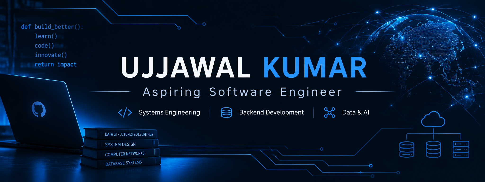

  

---
#  👋 About Me

### Aspiring Software Engineer | Systems & Software Development

I'm a B.Tech undergraduate interested in building software systems and understanding the technologies that power modern computing.

My interests span **Systems & Networking, Backend Development, Database Systems, Data Structures & Algorithms, and AI/ML**.

I primarily work with C++ and Python while exploring Java, backend architecture, network communication, and data-driven applications.

I'm particularly interested in understanding software beyond the application layer — from data structures and operating systems to network protocols, databases, and distributed infrastructure.

---

## 💻 Technical Skills

### Programming Languages

  

### Backend & Databases

  

### Systems & Infrastructure

  

### Data Analytics & AI/ML

  

### Development Tools

  

---

## 🧠 Core Computer Science

- **Data Structures & Algorithms:** Problem-solving, data structures, graph algorithms and algorithmic fundamentals.
- **Computer Networks:** TCP/IP, network protocols, packet analysis and communication systems.
- **Operating Systems:** Processes, memory management and operating system fundamentals.
- **Database Systems:** SQL, relational database design and data management.
- **Distributed Systems:** Server architecture, communication and infrastructure.

---

## 🌱 Currently Exploring

- Network communication and server infrastructure
- Operating systems and computer architecture
- Database internals and backend engineering
- Distributed systems and cloud computing
- Machine learning, neural networks and NLP

---

## 📊 GitHub Statistics

  
  

---

## 📈 Contribution Activity

  

---

## 🤝 Connect With Me

  
  
  

  <i>Always open to connecting, collaborating, and exploring new opportunities.</i>

---

## 🐍 Contribution Activity

  <picture>
    <source media="(prefers-color-scheme: dark)"
      srcset="https://raw.githubusercontent.com/UjjawalKr-01/UjjawalKr-01/output/github-contribution-grid-snake-dark.svg">
    <source media="(prefers-color-scheme: light)"
      srcset="https://raw.githubusercontent.com/UjjawalKr-01/UjjawalKr-01/output/github-contribution-grid-snake.svg">
    
  </picture>

